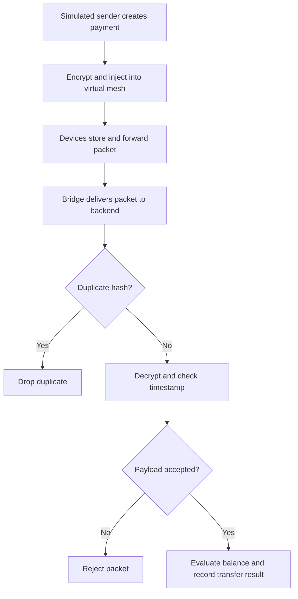

# 📡 UPI Without Internet
### Encrypted Payment Delivery Through a Simulated Mesh

**Java 17 · Spring Boot 3.3.5 · Spring Data JPA · H2 · Maven · JUnit 5**

## 🎯 Project Overview

UPI Without Internet is a backend prototype exploring how a payment instruction could move through nearby devices when the sender has no internet connection.

The application simulates a mesh of virtual devices that store and forward encrypted payment packets. A bridge device represents a participant with internet access. When its packets reach the backend, the application checks for duplicates, decrypts the payload, validates its timestamp, and processes a transfer between demo accounts.

**The focus is deferred settlement:** forwarding a payment instruction and settling it are separate steps. The repository demonstrates the backend and a software mesh simulator; real Bluetooth communication and bank integration are outside its current scope.

## ✨ Implementation Highlights

| Area | Implementation |
| --- | --- |
| 🔐 Payment encryption | AES-256-GCM encrypts each payload; RSA-2048 OAEP with SHA-256 encrypts its AES key. |
| 🔁 Duplicate detection | SHA-256 hashes identify repeated encoded ciphertext, with atomic claims through `ConcurrentHashMap.putIfAbsent`. |
| 📡 Mesh simulation | Five virtual devices exchange packets through gossip rounds with hop limits and local packet deduplication. |
| 💰 Ledger updates | Spring transactions group balance updates and ledger insertion; JPA optimistic locking detects concurrent account changes. |
| ⏱️ Freshness checks | The backend rejects payload timestamps older than 24 hours or more than five minutes into the future. |
| 📊 Interactive dashboard | A browser interface displays device state, account balances, transaction records, and an activity log. |

## 🧭 Payment Processing Flow

In the simulator, bridge delivery invokes the ingestion service directly. The application also exposes `POST /api/bridge/ingest` for HTTP-based packet submission.

## 🧠 Backend Design

### 🔐 Hybrid Encryption

Each payment receives a fresh AES key and a random initialization vector. AES-GCM protects the payment contents and detects payload tampering. RSA-OAEP wraps the AES key so the backend can recover it using its private key.

### 🔁 Concurrent Duplicate Handling

Multiple bridges may deliver the same packet. The idempotency service atomically claims its ciphertext hash before decryption, allowing one request to proceed while repeated submissions are dropped.

This cache operates within one application instance. A unique database constraint on the packet hash provides an additional duplicate-record safeguard.

### 💾 Transactional Settlement

The settlement service validates the amount and available balance, updates demo accounts, and records the result. It uses:

- `BigDecimal` for monetary values.
- `@Transactional` for grouped database changes.
- `@Version` for optimistic locking.
- Spring Data JPA repositories for account and transaction persistence.

## 🛠️ Technology Stack

| Layer | Technologies |
| --- | --- |
| Language | Java 17 |
| Backend | Spring Boot, Spring Web |
| Persistence | Spring Data JPA, Hibernate, H2 in-memory database |
| Cryptography | Java Cryptography Architecture, AES-GCM, RSA-OAEP, SHA-256 |
| Concurrency | ConcurrentHashMap, ExecutorService, CountDownLatch |
| Dashboard | Thymeleaf template, HTML, CSS, JavaScript Fetch API |
| Build and testing | Maven Wrapper, JUnit 5, Spring Boot Test |

## 🔌 Selected REST Endpoints

| Method | Endpoint | Purpose |
| --- | --- | --- |
| GET | `/api/server-key` | Retrieve the server public key |
| POST | `/api/demo/send` | Create an encrypted demo payment |
| GET | `/api/mesh/state` | Inspect virtual devices and held packets |
| POST | `/api/mesh/gossip` | Simulate a packet-forwarding round |
| POST | `/api/mesh/flush` | Process packets held by bridge devices |
| POST | `/api/bridge/ingest` | Submit a packet for backend processing |
| GET | `/api/accounts` | Retrieve demo account balances |
| GET | `/api/transactions` | Retrieve the latest 20 transaction records |

## 🧪 Included Automated Tests

The repository contains three Spring Boot integration tests:

- **Encryption round trip:** checks that encrypted payment data can be decrypted correctly.
- **Tampered packet rejection:** checks that modifying encrypted data produces an invalid result.
- **Concurrent duplicate delivery:** submits one packet from three threads and asserts one settlement, two duplicate drops, and a single balance transfer.

These describe the assertions in the test suite, rather than a published test-run result.

## 📌 Current Scope

- Device communication and internet availability are simulated in software.
- Transfers use seeded demo accounts and an in-memory ledger; no real money moves.
- The supplied PIN is hashed but is not verified against an account credential.
- Encryption protects payload contents; sender authentication and digital signatures are not implemented.
- The idempotency cache is local to one JVM, and both the database and generated RSA keys are temporary.
- Offline forwarding does not guarantee successful settlement or prevent creation of conflicting payment instructions.

## 🚀 Planned Improvements

- Align ingestion responses with the ledger status for insufficient-balance rejections.
- Add request validation and consistent error responses.
- Extend tests for expired packets, invalid amounts, and insufficient funds.
- Introduce persistent database storage and durable key management.
- Explore shared idempotency storage and authenticated bridge requests.

These are future enhancements and are not part of the current implementation.

## 🙏 Acknowledgment

This is a tutorial-based learning project using the implementation from [perryvegehan/UPI_Without_Internet](https://github.com/perryvegehan/UPI_Without_Internet). Credit for the original code and project foundation belongs to its creator.

